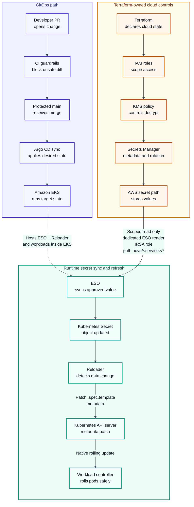

# NovaDeploy Platform: GitOps Administration Guide

*Deploying Services to Amazon EKS with Argo CD*  
Version 1.0 | Status: Full runbook | Written by: Jeff Slavin

Use this runbook to deploy NovaDeploy services, manage secrets safely, and recover from failed releases.

[Read the portfolio cut.](novadeploy-gitops-admin-guide-portfolio-cut.md)

!!! note "Portfolio Notice"
    NovaDeploy is a fictional portfolio platform. This sample contains no proprietary employer, client, or production information.

!!! info "Scope and Audience"
    **Scope:** GitOps on Amazon Elastic Kubernetes Service (EKS), AWS Identity and Access Management (IAM), AWS Key Management Service (KMS), Secrets Manager, External Secrets Operator (ESO), Reloader, verification, and rollback. Excludes application-code changes, broader incident response, and service-specific business logic.

    **Audience:** Platform engineers, DevOps/SRE operators, cloud engineers, and documentation reviewers of GitOps-managed Kubernetes services.

??? abstract page-contents "Contents"
    - [1. Quick Start and Stop Conditions](#1-quick-start-and-stop-conditions)
    - [2. Deployment Guardrails](#2-deployment-guardrails)
    - [3. Architecture Overview](#3-architecture-overview)
    - [4. Prerequisites and Tooling](#4-prerequisites-and-tooling)
    - [5. IAM, KMS, SecretStore, and ESO Setup](#5-iam-kms-secretstore-and-eso-setup)
    - [6. GitOps Repository Layout](#6-gitops-repository-layout)
    - [7. Argo CD Application and Sync Policy](#7-argo-cd-application-and-sync-policy)
    - [8. Deployment Verification](#8-deployment-verification)
    - [9. Rollback and Recovery](#9-rollback-and-recovery)
    - [10. Appendices](#10-appendices)

## 1. Quick Start and Stop Conditions

Use this workflow for non-emergency production deployments.

| Step | Action | What to Do | Stop Condition |
| --- | --- | --- | --- |
| 1 | Validate readiness | Check controller health, local tools, and guardrails before editing the deployment pull request (PR). | Stop if Argo CD, ESO, or Reloader is unhealthy. |
| 2 | Change declared state | Update Helm values, Argo CD Application resources, ExternalSecret custom resources (CRs), or Terraform-owned IAM/KMS metadata. | No plaintext secrets; follow the Secret Handling Rule below. |
| 3 | Open PR | Pass automated CI checks: lint, helm template, kubeconform, secret scan, and Reloader annotation guardrail. | Stop if any secret-consuming workload lacks the root Reloader annotation. |
| 4 | Merge to main | Merge after approval; Argo CD watches main and reconciles the application. | No direct pushes or kubectl edits. |
| 5 | Sync and verify | Wait for automated sync or run `argocd app sync <app-name>`; then run health, smoke, and secret-mount checks. | Do not use `--force` for normal deployment hotfixes. |
| 6 | Close or recover | Close only when the application is Synced/Healthy, smoke tests pass, and non-secret evidence is recorded. | Default to Git revert; use Argo CD history only for approved service-level agreement (SLA) emergencies. |

!!! info "Secret Handling Rule"
    AWS Secrets Manager stores values; ESO syncs them into Kubernetes Secret objects at runtime. Never commit, paste, or type plaintext secret values into files, manifests, or shells. Keep all secret values out of Git, PRs, ConfigMaps, literal environment variables, Terraform state, logs, chats, and tickets.

## 2. Deployment Guardrails

Apply these rules throughout the guide.

| Guardrail | Required Evidence | Pass Criteria |
| --- | --- | --- |
| Git is source of truth | Protected main; all changes through PRs; CI passes before merge | Manual cluster drift is rejected or reverted by Argo CD self-heal. |
| Terraform owns cloud controls | Terraform manages IAM roles, policies, KMS keys, Secrets Manager metadata, rotation config, and Lambda permissions | Use the AWS CLI only for read-only checks of these resources; direct changes to them require approved break-glass procedures, then reconciliation with Terraform. |
| No plaintext secrets | Secret scan, PR review, and no `aws_secretsmanager_secret_version` for production values | Follow the Secret Handling Rule in Section 1. |
| IRSA separation | Two IAM roles for service accounts (IRSA) per service: workload ServiceAccount has non-secret AWS permissions only; dedicated ESO reader ServiceAccount assumes `nova-<service>-eso-read` | Only ESO reads AWS Secrets Manager for service-scoped paths. |
| Namespace-scoped SecretStore | ExternalSecret uses `secretStoreRef.kind: SecretStore` in the workload namespace | ClusterSecretStore for app secrets requires an approved platform exception. |
| Reloader compatibility | Root workload metadata has `reloader.stakater.com/auto: "true"`; the Application sets `RespectIgnoreDifferences=true` and `ignoreDifferences` for the `reloader.stakater.com/last-reloaded-from` annotation | Reloader patches pod templates without Argo CD immediately removing its annotation. |
| Rotation gate | Keep `var.rotation_enabled` false until KMS policy, Lambda role, ESO readiness, Reloader role-based access control (RBAC), and mount checks pass | Verify every dependency in staging and obtain production approval before enabling rotation. |

### 2.1 Rotation Readiness Gate

Enable production rotation only after all staging checks pass and the change receives production approval.

- Run the cluster health check in Section 4.2.
- Confirm ESO can reconcile the target ExternalSecret and create/update the Kubernetes Secret.
- Confirm the KMS key policy permits the ESO reader role and, when rotation is enabled, the rotation Lambda execution role.
- Confirm Reloader can get/list/watch Secrets and ConfigMaps and patch workloads in the workload namespace.
- Confirm every secret-consuming Deployment, StatefulSet, or DaemonSet has `reloader.stakater.com/auto: "true"` on root workload metadata.
- Confirm the Argo CD Application ignores Reloader last-reloaded annotations and sets `RespectIgnoreDifferences=true`.
- Run the secret mount check in Section 8.2.
- Rotate the secret once in staging; confirm every consuming Deployment, StatefulSet, and DaemonSet started new pods (Section 8.3). CI checks the annotation, not the restart.

## 3. Architecture Overview



!!! note "Accessible Diagram Summary"
    Three paths connect: GitOps, Terraform-owned cloud controls, and runtime secret sync. GitOps moves reviewed PRs through CI, protected main, Argo CD, and Amazon EKS. Terraform defines IAM, KMS, Secrets Manager metadata, rotation config, and the approved AWS secret path.

    Amazon EKS hosts ESO, Reloader, application pods, and other runtime controllers. Only ESO reads AWS Secrets Manager through a dedicated IRSA role scoped to `nova/<service>/*`. Application pods have no broad Secrets Manager read access.

    ESO syncs the approved value into a Kubernetes Secret. Reloader detects changes and patches workload Pod template metadata through the Kubernetes API server, triggering a rolling restart by the workload controller.

## 4. Prerequisites and Tooling

Before opening a deployment PR, check compatibility with the platform team's pinned versions in the infrastructure repository.

| Tool / Resource | Requirement | Purpose |
| --- | --- | --- |
| AWS CLI | v2; approved role | EKS auth, read-only validation, approved secret seeding, and break-glass evidence |
| kubectl | Compatible with cluster | Health, rollout, RBAC, and Secret-object checks |
| Helm | 3.x; platform-pinned | Chart rendering for local validation and CI |
| Argo CD CLI | Compatible with server | Application status, sync, wait, history, rollback |
| Terraform | Version pinned by infra repo | IAM, KMS, Secrets Manager metadata, rotation config |
| External Secrets Operator | Platform-pinned; custom resource definitions (CRDs) installed | Syncs AWS Secrets Manager values to Kubernetes Secret objects |
| ESO controller RBAC | `create` on `serviceaccounts/token` for ServiceAccounts referenced by `auth.jwt.serviceAccountRef` | ESO requests short-lived projected tokens through the Kubernetes TokenRequest API |
| Reloader | Platform-pinned; reload strategy = annotations | Triggers rolling restarts when watched Secrets/ConfigMaps change |
| Python + PyYAML | Python 3.x and PyYAML | Fast CI guardrail for rendered workload annotations; approved secret-seeding script |
| Approved password manager or privileged access management (PAM) CLI | Platform-approved client, authenticated with multi-factor authentication (MFA) | Supplies the initial secret for seeding without exposing it to a shell |

### 4.1 Local Tool Validation

Check tools before editing the GitOps repository; resolve access or tooling failures before opening the PR.

```bash
aws --version
kubectl version --client=true
helm version --short
argocd version --client
terraform version
python3 -c "import yaml; print('PyYAML available')"
```

### 4.2 Cluster Health Check

Run before every release cycle; all controllers must be healthy before sync, rollback, or rotation. Save this block as a script and run it with `bash`. If you paste the block into a live shell, `set -e` and `exit 1` close the session on the first failed check.

The RBAC checks test controller ServiceAccount permissions with `kubectl auth can-i --as`, which requires permission to impersonate those accounts. Most production operators should lack broad impersonation rights. Without permission, have a platform administrator or approved CI identity run the block and attach non-secret results to the deployment ticket.

```bash
#!/usr/bin/env bash
set -euo pipefail

fail() {
  printf 'ERROR: %s\n' "$1" >&2
  exit 1
}

require_can_i_as() {
  local subject="$1"
  local message="$2"
  shift 2

  if ! kubectl auth can-i "$@" --as "${subject}" --quiet; then
    fail "${message}"
  fi
}

kubectl wait --for=condition=Ready node --all --timeout=120s \
  || fail "One or more cluster nodes are not Ready."

kubectl wait --for=condition=Available deployment --all \
  -n argocd --timeout=120s \
  || fail "One or more Argo CD deployments are unavailable."

kubectl rollout status statefulset/argocd-application-controller \
  -n argocd --timeout=120s \
  || fail "Argo CD application controller is not ready."

kubectl wait --for=condition=Available deployment --all \
  -n <eso-controller-namespace> --timeout=120s \
  || fail "One or more ESO deployments are unavailable."

kubectl wait --for=condition=Available deployment --all \
  -n <reloader-namespace> --timeout=120s \
  || fail "Reloader is unavailable."

RELOADER_STRATEGY=$(kubectl get deploy <reloader-deployment-name> \
  -n <reloader-namespace> \
  -o jsonpath='{.spec.template.spec.containers[*].args}' \
  | tr '",[]' '    ')

printf '%s\n' "${RELOADER_STRATEGY}" \
  | grep -Eqi '(^|[[:space:]])(--)?reload-strategy[=[:space:]]+annotations([[:space:]]|$)' \
  || fail "Reloader is not configured with the required annotations reload strategy."

ESO_SA=$(kubectl get deploy <eso-controller-deployment-name> \
  -n <eso-controller-namespace> \
  -o jsonpath='{.spec.template.spec.serviceAccountName}')

RELOADER_SA=$(kubectl get deploy <reloader-deployment-name> \
  -n <reloader-namespace> \
  -o jsonpath='{.spec.template.spec.serviceAccountName}')

test -n "${ESO_SA}" \
  || fail "Could not resolve the ESO controller ServiceAccount."

test "${RELOADER_SA}" = "<reloader-sa-name>" \
  || fail "Reloader is using '${RELOADER_SA}', not the expected '<reloader-sa-name>'."

ESO_SUBJECT="system:serviceaccount:<eso-controller-namespace>:${ESO_SA}"
RELOADER_SUBJECT="system:serviceaccount:<reloader-namespace>:${RELOADER_SA}"

require_can_i_as \
  "${ESO_SUBJECT}" \
  "ESO cannot create TokenRequest objects for the referenced ServiceAccount in <namespace>." \
  create serviceaccounts/<service>-eso-secret-reader \
    --subresource=token -n <namespace>

for verb in get list watch; do
  require_can_i_as \
    "${RELOADER_SUBJECT}" \
    "Reloader cannot ${verb} Secrets in <namespace>." \
    "${verb}" secrets -n <namespace>

  require_can_i_as \
    "${RELOADER_SUBJECT}" \
    "Reloader cannot ${verb} ConfigMaps in <namespace>." \
    "${verb}" configmaps -n <namespace>
done

for workload in deployments.apps statefulsets.apps daemonsets.apps; do
  for verb in get list update patch; do
    require_can_i_as \
      "${RELOADER_SUBJECT}" \
      "Reloader cannot ${verb} ${workload} in <namespace>." \
      "${verb}" "${workload}" -n <namespace>
  done
done
```

The strategy check normalizes the `jsonpath` `args` array to match both `--reload-strategy=annotations` and `--reload-strategy annotations`. Verify the flag name against the platform-pinned Reloader chart version before relying on this check.

| Component | Pass Criteria |
| --- | --- |
| Nodes | All schedulable nodes are Ready with no unexpected NoSchedule taints. |
| Argo CD | server, repo-server, application-controller, and dex are Running. |
| ESO | Controller and webhook are Running; the controller can `create` `serviceaccounts/token` in the referenced ServiceAccount's namespace; ExternalSecret becomes Ready after apply. |
| Reloader | Live deployment uses the annotations reload strategy and can read watched Secrets/ConfigMaps and update each supported workload type. |
| EKS API-data encryption | Below Kubernetes 1.28, explicitly configure Secrets envelope encryption. EKS 1.28 or later provides default envelope encryption for all Kubernetes API data. See the [AWS default envelope encryption documentation](https://docs.aws.amazon.com/eks/latest/userguide/envelope-encryption.html). |

## 5. IAM, KMS, SecretStore, and ESO Setup

!!! info "Section Summary"
    Create two narrowly scoped IRSA roles per service: workload and ESO reader. Terraform manages cloud resources; Kubernetes manifests bind the matching ServiceAccounts.

### 5.1 Role Model

| Role / Account | Used By | Allowed Access | Explicitly Not Allowed |
| --- | --- | --- | --- |
| `nova-<service>-prod` | Workload ServiceAccount `<workload-sa-name>` | Required non-secret AWS APIs only, such as S3 or DynamoDB | No Secrets Manager read permissions |
| `nova-<service>-eso-read` | ServiceAccount `<service>-eso-secret-reader` | `secretsmanager:GetSecretValue`, `DescribeSecret`, and `ListSecretVersionIds` for `nova/<service>/*`, plus KMS decrypt through Secrets Manager | No paths outside `nova/<service>/*`; no trust for other service accounts |
| rotation Lambda role | Approved Secrets Manager rotation Lambda | Rotation-only actions and KMS use through Secrets Manager when rotation is enabled | Not present in KMS policy while `var.rotation_enabled=false` |

### 5.2 Terraform Pattern

Confirm the EKS OpenID Connect (OIDC) issuer before provisioning IRSA. This check is read-only; create IAM resources through Terraform.

```bash
aws eks describe-cluster \
  --name <cluster-name> \
  --region <region> \
  --query "cluster.identity.oidc.issuer" \
  --output text
```

Manage service IAM resources in `infra/iam/<service>.tf`. This example restricts the ESO reader role to its dedicated secret-reader ServiceAccount.

```hcl
locals {
  oidc_provider = replace(var.oidc_provider_url, "https://", "")
  eso_sa_sub    = "system:serviceaccount:${var.namespace}:${var.service}-eso-secret-reader"
}

data "aws_iam_policy_document" "eso_assume_role" {
  statement {
    actions = ["sts:AssumeRoleWithWebIdentity"]
    principals {
      type        = "Federated"
      identifiers = ["arn:aws:iam::${var.account_id}:oidc-provider/${local.oidc_provider}"]
    }
    condition {
      test     = "StringEquals"
      variable = "${local.oidc_provider}:aud"
      values   = ["sts.amazonaws.com"]
    }
    condition {
      test     = "StringEquals"
      variable = "${local.oidc_provider}:sub"
      values   = [local.eso_sa_sub]
    }
  }
}

resource "aws_iam_role" "eso_read" {
  name               = "nova-${var.service}-eso-read"
  assume_role_policy = data.aws_iam_policy_document.eso_assume_role.json
}
```

Attach the secret-read policy only to `nova-<service>-eso-read`, never the workload role. Pass the Amazon Resource Name (ARN) of the service secret's KMS encryption key through the typed `secrets_kms_key_arn` input.

```hcl
variable "secrets_kms_key_arn" {
  description = "ARN of the KMS key that encrypts this service's Secrets Manager secrets"
  type        = string
}

data "aws_iam_policy_document" "eso_read" {
  statement {
    actions = [
      "secretsmanager:GetSecretValue",
      "secretsmanager:DescribeSecret",
      "secretsmanager:ListSecretVersionIds"
    ]
    resources = [
      "arn:aws:secretsmanager:${var.region}:${var.account_id}:secret:nova/${var.service}/*"
    ]
  }

  statement {
    actions   = ["kms:Decrypt"]
    resources = [var.secrets_kms_key_arn]
    condition {
      test     = "StringEquals"
      variable = "kms:ViaService"
      values   = ["secretsmanager.${var.region}.amazonaws.com"]
    }
  }
}

resource "aws_iam_role_policy" "eso_read" {
  name   = "nova-${var.service}-eso-read"
  role   = aws_iam_role.eso_read.id
  policy = data.aws_iam_policy_document.eso_read.json
}
```

!!! info "KMS Source of Truth"
    Use the same KMS key ARN for the Secrets Manager secret, `nova-<service>-eso-read` IAM policy, KMS key policy, and rotation Lambda role policy. For a shared externally managed key, verify its policy before merge.

### 5.3 ServiceAccount and SecretStore Manifests

Prefer storing ServiceAccount manifests in `charts/` so IAM bindings stay under version control. Keep workload and ESO reader ServiceAccounts separate.

```yaml
apiVersion: v1
kind: ServiceAccount
metadata:
  name: <service>-eso-secret-reader
  namespace: <namespace>
  annotations:
    eks.amazonaws.com/role-arn: arn:aws:iam::<ACCOUNT_ID>:role/nova-<service>-eso-read
```

Define each service's SecretStore in its workload namespace. ClusterSecretStore for application secrets requires a platform-approved cross-namespace exception.

```yaml
apiVersion: external-secrets.io/v1
kind: SecretStore
metadata:
  name: aws-secrets-manager-<service>
  namespace: <namespace>
spec:
  provider:
    aws:
      service: SecretsManager
      region: <region>
      auth:
        jwt:
          serviceAccountRef:
            name: <service>-eso-secret-reader
---
apiVersion: external-secrets.io/v1
kind: ExternalSecret
metadata:
  name: <service>-app-secrets
  namespace: <namespace>
spec:
  refreshInterval: 5m
  secretStoreRef:
    name: aws-secrets-manager-<service>
    kind: SecretStore
  target:
    name: <service>-app-secrets
    creationPolicy: Owner
  data:
    - secretKey: DATABASE_PASSWORD
      remoteRef:
        key: nova/<service>/db
        property: password
```

`remoteRef.key` must match the Terraform-managed Secrets Manager name pattern: `nova/<service>/<secret_name>`. Do not use kubectl, Git, or Terraform to set production secret values.

### 5.4 Approved Secret-Seeding Workflow

An approved administrator seeds each production secret once to create its first AWSCURRENT version. This is the only approved human write path. Terraform manages metadata, KMS policy, and rotation config; never use `aws_secretsmanager_secret_version` for production values (Section 2).

!!! warning "Where Seeding Is Allowed to Happen"
    If production secrets are forbidden on workstations, run these commands through the PAM session broker, an approved bastion or jump host, or CI. CI must assume the seeding role through OIDC and read from the approved secret broker. Record the seeding path in the deployment ticket.

1. A platform administrator confirms the initial value is available through the approved password manager or PAM workflow without displaying or copying it.

2. The administrator opens a private MFA session. **Never type, paste, echo, or interpolate the secret into a shell.** It flows only from the password manager through the input stream to AWS.

    !!! danger "Do Not Disable Session Controls"
        Keep shell history and terminal recording enabled for step 5's required PAM audit trail. The script keeps values out of process arguments (`argv`) and shell history.

3. Disable the AWS CLI's optional command history (`cli_history`) before seeding: `aws configure set cli_history disabled`. It records request parameters, including secret values, on the host. It is off by default; repeating this command is safe.

    The script stops if a value already exists. Otherwise, it passes a single-line value from a successful password-manager CLI call to `put-secret-value` through standard input, creating the first AWSCURRENT version without writing plaintext files.

    The initial check cannot prevent concurrent seeding. Assign one person or job per secret in the deployment ticket; only that assignee may run the script.

    As a backstop, the script sends a fixed version ID (`--client-request-token`) built from the ticket and secret name. Secrets Manager rejects a second overlapping write unless its value matches the first.

    Save as `seed-secret.py`; replace placeholders with your approved command, resource names, and deployment ticket ID. Sign in to the password manager, then run `python3 seed-secret.py` on an approved Linux or macOS host. The password-manager command must output only the password; never put the password in the script. Captured password-manager output may hide sign-in prompts or errors.

    ```python
    import json
    import subprocess
    import sys
    import uuid

    SECRET_ID = "nova/<service>/<secret_name>"
    TICKET_ID = "<deployment-ticket-id>"

    # A fixed version ID for this seeding. If two seedings overlap, Secrets
    # Manager accepts the second write only when its value matches the first.
    VERSION_ID = str(uuid.uuid5(uuid.NAMESPACE_URL, TICKET_ID + "/" + SECRET_ID))

    try:
        check = subprocess.run(
            [
                "aws", "secretsmanager", "describe-secret",
                "--secret-id", SECRET_ID,
                "--output", "json",
            ],
            stdout=subprocess.PIPE,
            check=True,
        )
        has_value = bool(json.loads(check.stdout).get("VersionIdsToStages"))
    except OSError:
        sys.exit("Could not start the AWS CLI.")
    except (subprocess.CalledProcessError, ValueError):
        sys.exit("Could not check the secret; nothing was written.")

    if has_value:
        sys.exit("The secret already has a value; nothing was written.")

    try:
        result = subprocess.run(
            ["<password-manager-cli>", "read", "<pm-item-reference>"],
            stdout=subprocess.PIPE,
            stderr=subprocess.PIPE,
            check=True,
        )
        raw = result.stdout
        # Remove one normal command-output line ending.
        if raw.endswith(b"\r\n"):
            raw = raw[:-2]
        elif raw.endswith(b"\n"):
            raw = raw[:-1]
        password = raw.decode("utf-8")
    except (OSError, subprocess.CalledProcessError, UnicodeError):
        sys.exit("Password retrieval failed; nothing was written.")

    if not password or "\r" in password or "\n" in password:
        sys.exit("Expected one nonempty password line; nothing was written.")

    try:
        outcome = subprocess.run(
            [
                "aws", "secretsmanager", "put-secret-value",
                "--secret-id", SECRET_ID,
                "--secret-string", "file:///dev/stdin",
                "--client-request-token", VERSION_ID,
            ],
            input=json.dumps({"password": password}).encode("utf-8"),
        )
    except OSError:
        sys.exit("Could not start the AWS CLI.")

    sys.exit(outcome.returncode)
    ```

    !!! danger "Never Place the Value in argv"
        Never use `--secret-string "$(<password-manager-cli> read ...)"` or hand-write JSON in a heredoc. Command substitution exposes plaintext process arguments to `ps` and local processes while running. A heredoc requires pasting the value into the terminal, forbidden by step 2.

    If the approved password-manager CLI is unavailable or the value contains line breaks, stop and use a separately approved seeding workflow.

4. Verify with `describe-secret` only. Do not use `get-secret-value` during deployment verification.

    ```bash
    aws secretsmanager describe-secret \
      --secret-id nova/<service>/<secret_name> \
      --query "{Name:Name,VersionIdsToStages:VersionIdsToStages,KmsKeyId:KmsKeyId}"
    ```

5. Record only non-secret evidence in the deployment ticket: secret ARN/name, KMS key ID, AWSCURRENT version ID, seeding path used (workstation, PAM, bastion, or CI), approver, timestamp, and rotation-readiness status.

## 6. GitOps Repository Layout

This GitOps repository defines NovaDeploy cluster state; application code lives in separate repositories.

```text
nova-gitops/
  apps/                          # Argo CD Application manifests
  clusters/production/           # AppProject, root app, namespaces, policy baseline
  charts/<service>/              # Service Helm chart
  envs/production/values/        # Production value overrides
  secrets/external/              # ExternalSecret CRs only; no plaintext secrets
  infra/iam/<service>.tf         # IAM, KMS, Secrets Manager metadata, rotation config
  scripts/check-reloader-annotations.sh
  .github/workflows/             # lint, render, kubeconform, secret scan, guardrails
```

| Path | Owner | Review Focus |
| --- | --- | --- |
| `apps/` | Platform engineering | Application project, destination, sync policy, `ignoreDifferences` |
| `clusters/production/` | Platform engineering | AppProject, sync windows, namespace baseline |
| `charts/<service>/` | Service team + platform reviewer | Workload metadata annotations, probes, resources, service accounts |
| `envs/production/values/` | Service team | Image tag, config values, environment-specific overrides |
| `secrets/external/` | Platform engineering | ExternalSecret references only; no secret values |
| `infra/iam/<service>.tf` | Platform engineering | IAM trust boundaries, KMS policy, Secrets Manager metadata, rotation gates |
| `scripts/` | Platform engineering | Guardrail correctness, fail-closed behavior, and portability |
| `.github/workflows/` | Platform engineering | Required checks, pinned actions, and least-privilege workflow permissions |

## 7. Argo CD Application and Sync Policy

Before workload sync, create production namespaces through `clusters/production/` with NetworkPolicy, ResourceQuota, LimitRange, labels, and admission policies.

!!! warning "Auto-Prune Boundary"
    Enable production `prune: true` only when the production AppProject and sync windows constrain the Application. Otherwise, a bad merge, path mistake, or unauthorized destination can trigger automatic deletion.

Configure both: `ignoreDifferences` excludes the Reloader-managed annotation from comparisons of live and desired state; `RespectIgnoreDifferences=true` also excludes it during sync.

```yaml
apiVersion: argoproj.io/v1alpha1
kind: Application
metadata:
  name: api-gateway
  namespace: argocd
spec:
  project: novadeploy-production
  source:
    repoURL: https://github.example.com/novadeploy/nova-gitops
    targetRevision: main
    path: charts/api-gateway
    helm:
      valueFiles:
        - ../../envs/production/values/api-gateway.yaml
  destination:
    server: https://kubernetes.default.svc
    namespace: api-gateway
  syncPolicy:
    automated:
      prune: true
      selfHeal: true
    syncOptions:
      - ServerSideApply=true
      - RespectIgnoreDifferences=true
  ignoreDifferences:
    - group: apps
      kind: Deployment
      jsonPointers:
        - /spec/template/metadata/annotations/reloader.stakater.com~1last-reloaded-from
    - group: apps
      kind: StatefulSet
      jsonPointers:
        - /spec/template/metadata/annotations/reloader.stakater.com~1last-reloaded-from
    - group: apps
      kind: DaemonSet
      jsonPointers:
        - /spec/template/metadata/annotations/reloader.stakater.com~1last-reloaded-from
```

| Setting | Meaning | Operational Note |
| --- | --- | --- |
| `prune: true` | Sync deletes cluster resources removed from Git. | Treat deletions as production changes; require review. |
| `selfHeal: true` | Manual drift is reverted to Git state. | Do not hotfix production with direct kubectl edits. |
| `ServerSideApply=true` | Kubernetes tracks field ownership during apply. | Useful for resources not fully managed by Argo CD. Uses `--force-conflicts`, taking over conflicting fields. |
| `RespectIgnoreDifferences=true` | Argo CD respects `ignoreDifferences` during sync. | Prevents sync from removing Reloader last-reloaded annotations. |
| No `CreateNamespace=true` | Service apps do not create production namespaces ad hoc. | Cluster baseline creates namespaces with required policy first. |

### 7.1 Sync Windows

The AppProject defines sync windows. The matching `allow` window blocks automated and manual sync outside its schedule; optional `deny` windows block periods within it. Nights and weekends need no separate deny window.

| Window / State | Effect | Operator Action |
| --- | --- | --- |
| Monday-Friday 09:00-17:00 UTC; matching allow window active | Routine automated or manual sync permitted after PR approval. | Sync, then complete Section 8 verification. |
| All other times; no matching allow window active | Routine sync blocked, including Monday-Thursday overnight. | Wait for the next allow window unless an approved incident requires manual override. |
| Approved emergency manual override | `manualSync` is temporarily enabled on the matching allow window. | Enable by window ID, manually sync once, verify, and immediately disable the override. |

## 8. Deployment Verification

Close the deployment ticket only after all checks pass with no secret values in evidence. Validate only object state, expected key names, mount success, rollout state, and recent pod creation time.

### 8.1 Health and Secret Checks

```bash
argocd app get <app-name> --refresh
argocd app wait <app-name> --sync --health
kubectl rollout status deployment/<service> -n <namespace>

kubectl get externalsecret <service>-app-secrets -n <namespace>
kubectl describe externalsecret <service>-app-secrets -n <namespace>
kubectl get secret <service>-app-secrets -n <namespace>
kubectl get secret <service>-app-secrets -n <namespace> \
  -o go-template='{{range $k, $_ := .data}}{{printf "%s\n" $k}}{{end}}'
# Expected: ExternalSecret Ready=True and expected key names are present.
# Never print or decode values.
```

### 8.2 Secret Mount Check

This disposable pod checks Secret mounting and readability, printing only `secret-mounted` on success. Removing any previous pod ensures fresh results; `&&` stops the sequence if removal or a later step fails.

The manifest meets the restricted Pod Security profile and resource controls in `clusters/production/` (Section 7). Pods lacking `securityContext` or `resources` are rejected before mounting. Run in the Secret's workload namespace; mounts cannot be checked across namespaces.

```bash
kubectl delete pod secret-mount-check -n <namespace> --ignore-not-found &&
cat <<'EOF' | kubectl apply -n <namespace> -f - &&
apiVersion: v1
kind: Pod
metadata:
  name: secret-mount-check
spec:
  restartPolicy: Never
  automountServiceAccountToken: false
  securityContext:
    runAsNonRoot: true
    runAsUser: 1000
    runAsGroup: 1000
    fsGroup: 1000
    seccompProfile:
      type: RuntimeDefault
  containers:
    - name: secret-mount-check
      image: busybox:1.36
      command: ["sh", "-ec", "test -s /mnt/secrets/DATABASE_PASSWORD && test -r /mnt/secrets/DATABASE_PASSWORD && echo secret-mounted"]
      securityContext:
        allowPrivilegeEscalation: false
        capabilities:
          drop: ["ALL"]
      resources:
        requests:
          cpu: 10m
          memory: 16Mi
        limits:
          cpu: 50m
          memory: 32Mi
      volumeMounts:
        - name: app-secrets
          mountPath: /mnt/secrets
          readOnly: true
  volumes:
    - name: app-secrets
      secret:
        secretName: <service>-app-secrets
        defaultMode: 0440
EOF
kubectl wait --for=jsonpath='{.status.phase}'=Succeeded pod/secret-mount-check \
  -n <namespace> --timeout=60s &&
kubectl logs secret-mount-check -n <namespace>
kubectl delete pod secret-mount-check -n <namespace> --ignore-not-found
```

| Field | Why it is required |
| --- | --- |
| `runAsNonRoot: true` plus `runAsUser` | Restricted Pod Security requires a non-root user. `busybox:1.36` defaults to root, so `runAsNonRoot` alone causes `CreateContainerConfigError`; specify a user ID (UID). |
| `allowPrivilegeEscalation: false`, `capabilities.drop: ["ALL"]`, `seccompProfile.type: RuntimeDefault` | Remaining restricted-profile requirements; omitting any rejects the pod at admission. |
| `resources` requests and limits | The namespace baseline applies ResourceQuota and LimitRange. Quotas covering requests or limits reject pods without resources unless a LimitRange supplies defaults. |
| `automountServiceAccountToken: false` | Disposable debug pods in namespaces with IRSA separation must not receive projected ServiceAccount tokens. |
| `fsGroup: 1000` with `defaultMode: 0440` | Kubernetes assigns the mounted Secret's group ownership to `fsGroup`, letting the non-root UID read it regardless of cluster defaults. |

!!! warning "Mount Mode and UID Are Coupled"
    Default Secret mode 0644 allows any UID to read the file. With 0400 and no `fsGroup`, non-root containers cannot read it: `test -s` passes for the existing, nonempty file, but `test -r` fails. This can resemble a mount failure. Set `defaultMode` and `fsGroup` explicitly, as above.

!!! note "kubectl Compatibility"
    `--for=jsonpath` requires kubectl 1.23 or later. The pod exits immediately, so `--for=condition=Ready` can miss a successful check and time out. On older clients, poll: `kubectl get pod secret-mount-check -n <namespace> -o jsonpath='{.status.phase}'`.

**Pass criteria.** The pod reaches Succeeded, logs exactly `secret-mounted`, and is deleted. If admission rejects it, first align the manifest with the namespace's Pod Security level and resource controls; rejection does not establish a Secret problem.

### 8.3 Reloader Confirmation

```bash
kubectl rollout status deployment/<service> -n <namespace>
kubectl get deploy <service> -n <namespace> \
  -o go-template='{{range $k, $_ := .spec.template.metadata.annotations}}{{printf "%s\n" $k}}{{end}}'
kubectl get pods -n <namespace> -l app=<service> \
  --sort-by=.metadata.creationTimestamp
argocd app get <app-name> --refresh
# Expected: pods were recreated after a Secret data change; app remains Synced / Healthy.
# If a periodic ESO refresh changes no Secret data, Reloader does not restart pods.
```

## 9. Rollback and Recovery

!!! warning "Rollback Principle"
    Default to Git revert to preserve the source of truth and audit trail. Argo CD history rollback requires an approved emergency exception (break-glass), followed by a matching Git revert to restore Git/cluster consistency.

| Scenario | Strategy | Operator Note |
| --- | --- | --- |
| Bad image tag promoted | Git revert | Revert the image-bump commit, pass CI, merge, then sync or wait for automation. |
| Wrong Helm values or Application manifest | Git revert | Follow Section 9.1. |
| Application unreachable and SLA at risk | Argo CD history rollback | Use only if Argo CD and the Kubernetes API are reachable and Git revert cannot meet the SLA. Follow Section 9.2. |
| GitHub or CI outage blocks revert | Argo CD history rollback | Roll back to the last-good revision during the outage; record non-secret evidence. Follow Section 9.2. |
| Secret value misconfiguration | Secrets Manager rollback + ESO re-sync | Roll back through the approved secret process. Use Git revert only for SecretStore, ExternalSecret, IAM, KMS, or rotation-config changes. |
| Cluster unreachable | Infrastructure troubleshooting | Do not use Argo CD. Troubleshoot EKS control plane, networking, IAM, and node health first. |

### 9.1 Git Revert

1. Identify the bad commit SHA and the last-good commit in `nova-gitops`.

2. Create a revert branch from protected main.

3. Check whether the bad commit is single-parent or a merge commit.

4. Revert the bad commit and push the revert branch.

5. Open a PR, require emergency approval, merge, then sync or wait for automation.

6. Complete Section 8 verification before closing the incident.

```bash
git checkout main && git pull
git checkout -b revert/<bad-sha>

git show -s --format=%P <bad-sha>
# If one parent SHA is returned:
git revert <bad-sha> --no-edit
# If two or more parent SHAs are returned, keep main as parent 1:
git revert -m 1 <bad-sha> --no-edit

git push origin revert/<bad-sha>
```

If the allow schedule blocks an approved emergency sync, use this manual-sync override. Automated sync remains blocked outside the allow window.

```bash
argocd proj windows list <project>
argocd proj windows enable-manual-sync <project> <allow-window-id>
argocd app sync <app-name> --prune
argocd app wait <app-name> --health
argocd proj windows disable-manual-sync <project> <allow-window-id>
```

### 9.2 Argo CD History Rollback

Use only when Git revert cannot meet the SLA deadline. Suspend any App-of-Apps root app managing child Application CRs during the approved incident window; otherwise, it may re-enable the child and re-sync the broken commit.

During a GitHub outage, add `--validate=false` to both `argocd app set` commands below to allow changes without repository access. Rollback requires the last-good revision in Argo CD's manifest cache or local repository copy; a history entry alone is insufficient.

1. Confirm Argo CD and the Kubernetes API are reachable.

2. Record the root and target Applications' current sync policies in the incident ticket. Do not export and re-apply full live Application objects: they include server-managed fields and may bypass Git-managed definitions.

3. Suspend the App-of-Apps root app, then disable auto-sync on the target Application.

4. If the allow window is closed, first enable the manual-sync override. Roll back the target to the last-good revision, wait for health, then disable the override.

5. Keep both suspended until the matching Git revert merges.

```bash
argocd app get <root-app-name> --refresh
argocd app get <app-name> --refresh
argocd app resources <root-app-name>
argocd app set <root-app-name> --sync-policy none
argocd app set <app-name> --sync-policy none
argocd app history <app-name>
# If the allow window is closed, also run the "proj windows" commands.
argocd proj windows list <project>
argocd proj windows enable-manual-sync <project> <allow-window-id>
argocd app rollback <app-name> <history-id>
argocd app wait <app-name> --health
argocd proj windows disable-manual-sync <project> <allow-window-id>
# Leave both Applications on --sync-policy none until the mandatory Git revert merges.
```

History rollback leaves resources added by the bad commit until Git revert syncs. If one causes the incident, review and approve every resource marked `ignored (requires pruning)` in step 4's output: `--prune` deletes all, including resources from other commits. Repeat step 4, adding `--prune` to `argocd app rollback` and replacing the health wait with `kubectl rollout status deployment/<service> -n <namespace>`. After a rollback with pruning, Argo CD versions earlier than 3.4 can report `Missing` until Git revert merges, preventing the health wait from returning.

Restore Git and cluster consistency after the incident:

1. Open a Jira ticket tagged `[gitops-debt]`.

2. Complete the matching Git revert within 24 hours.

3. After the revert PR merges, use `argocd app set` to restore both Applications' exact pre-incident, Git-declared policies.

4. Refresh both Applications; confirm their pre-incident sync policies and reverted Git revision.

This example assumes both Applications normally use automated sync, prune, and self-heal. Remove flags not enabled in the Git-managed definition.

```bash
argocd app set <app-name> \
  --sync-policy automated \
  --auto-prune \
  --self-heal

argocd app set <root-app-name> \
  --sync-policy automated \
  --auto-prune \
  --self-heal

argocd app get <app-name> --refresh
argocd app get <root-app-name> --refresh
```

## 10. Appendices

### 10.1 CI Reloader Annotation Guardrail

The guardrail checks every rendered workload, preventing one correct Deployment annotation from hiding missing root annotations on other secret-consuming workloads. Match the Helm release name to `Application.metadata.name` (or `source.helm.releaseName` if set), and `--namespace` to `Application.spec.destination.namespace`.

```bash
#!/usr/bin/env bash
set -euo pipefail

rendered="$(mktemp)"
trap 'rm -f "$rendered"' EXIT

release_name="<app-name>"          # Application.metadata.name
target_namespace="<namespace>"     # Application.spec.destination.namespace

helm template "${release_name}" charts/<service> \
  --namespace "${target_namespace}" \
  -f envs/production/values/<service>.yaml \
  > "$rendered"

python3 - "$rendered" <<'PY'
import sys
import yaml

WORKLOADS = {"Deployment", "StatefulSet", "DaemonSet"}
SECRET_KEYS = {"secretKeyRef", "secretRef", "secretName", "secret"}  # "secret": projected volume sources


def uses_secret(node):
    if isinstance(node, dict):
        return bool(SECRET_KEYS & node.keys()) or any(
            uses_secret(value) for value in node.values()
        )
    if isinstance(node, list):
        return any(uses_secret(value) for value in node)
    return False


missing = []

with open(sys.argv[1], encoding="utf-8") as rendered:
    for obj in yaml.safe_load_all(rendered):
        if not isinstance(obj, dict) or obj.get("kind") not in WORKLOADS:
            continue

        meta = obj.get("metadata") or {}
        pod = obj.get("spec", {}).get("template", {}).get("spec", {})
        annotations = meta.get("annotations") or {}

        if (
            uses_secret(pod)
            and annotations.get("reloader.stakater.com/auto") != "true"
        ):
            missing.append(
                f'{obj["kind"]}/{meta.get("name", "<unknown>")}'
            )

if missing:
    print(
        'ERROR: secret-consuming workloads missing '
        'reloader.stakater.com/auto="true":',
        file=sys.stderr,
    )
    print(
        "\n".join(f"  - {item}" for item in missing),
        file=sys.stderr,
    )
    sys.exit(1)
PY
```

The temporary file and `set -euo pipefail` stop the job before Python if `helm template` fails. The script checks Deployment, StatefulSet, and DaemonSet pod specs without false positives from Ingress `tls.secretName`. Use kubeconform and admission policy for broader structural checks.

### 10.2 Evidence Checklist

| Evidence Item | Acceptable Example | Forbidden Evidence |
| --- | --- | --- |
| Argo CD state | Screenshot or text showing Synced / Healthy | None |
| ExternalSecret state | Ready=True, SecretSynced reason, recent refresh time | Secret value output |
| Kubernetes Secret | Object and expected key names exist | Decoded data or base64 content |
| Mount check | Disposable pod reached Succeeded; log shows only secret-mounted | cat/print of mounted file content |
| Reloader rollout | Rollout status and pod creation times after a Secret data change | Secret payload |
| Rollback | Revert PR link, approval, commit SHA, app health after sync | Manual kubectl patch not represented in Git |

### 10.3 Common Placeholders

| Placeholder | Meaning | Example |
| --- | --- | --- |
| `<ACCOUNT_ID>` | AWS account ID | `123456789012` |
| `<region>` | AWS region for EKS, Secrets Manager, and KMS | `us-east-1` |
| `<namespace>` | Workload Kubernetes namespace | `api-gateway` |
| `<service>` | NovaDeploy service name | `api-gateway` |
| `<cluster-name>` | EKS cluster name | `nova-prod` |
| `<app-name>` | Argo CD Application name | `api-gateway` |
| `<project>` | Argo CD AppProject name | `novadeploy-production` |
| `<bad-sha>` | Git commit SHA being reverted | `3d1a7f0` |
| `<history-id>` | Argo CD history ID (`argocd app history` ID column) | `42` |
| `<root-app-name>` | App-of-Apps root Application name | `novadeploy-production-root` |
| `<secret_name>` | Service-scoped Secrets Manager secret suffix | `db` |
| `<deployment-ticket-id>` | Deployment ticket ID; combined with the secret name in `seed-secret.py` for the fixed version ID | `DEP-1842` |
| `<password-manager-cli>` | Approved password manager or PAM command-line client | `op` |
| `<pm-item-reference>` | Item reference within the approved password manager | `op://Platform/nova-api-gateway-db/password` |
| `<allow-window-id>` | Argo CD sync-window ID | `7` |
| `<workload-sa-name>` | Workload Kubernetes ServiceAccount | `api-gateway-sa` |
| `<eso-controller-namespace>` | Namespace where ESO runs | `external-secrets` |
| `<eso-controller-deployment-name>` | ESO controller Deployment name | `external-secrets` |
| `<reloader-namespace>` | Namespace where Reloader runs | `reloader` |
| `<reloader-deployment-name>` | Reloader Deployment name | `reloader` |
| `<reloader-sa-name>` | Expected Reloader ServiceAccount name | `reloader` |

